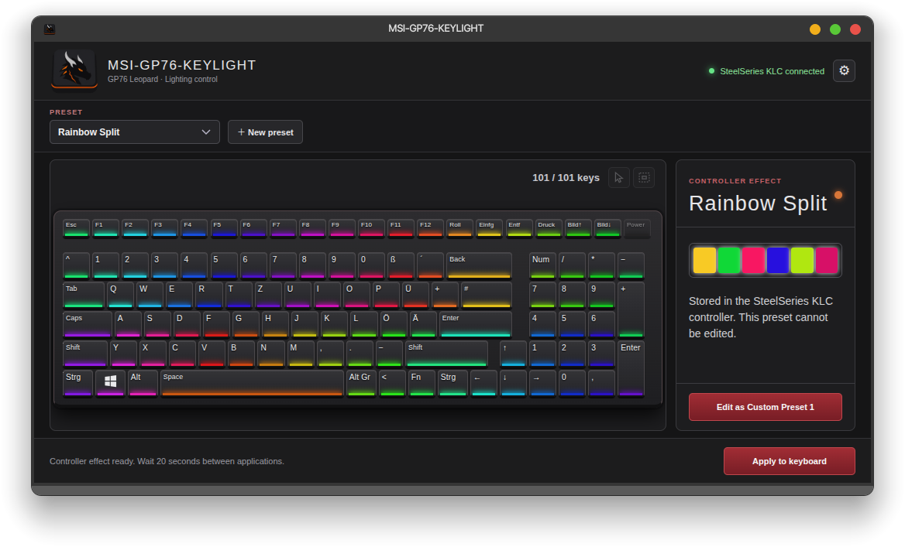

# MSI-GP76-KEYLIGHT


A compact Linux Electron/React app for the MSI GP76 per-key keyboard lighting controller. Preview controller effects, create custom key colors, and apply a preset to the keyboard on demand.

I wanted to build this app because the keyboard backlight on my MSI GP76 wasn't working on Windows. That led me to create a friendly Linux app with a clean GUI for choosing effects and making my own lighting presets. 🐉✨



## Requirements 🧰

- Linux x86-64; Node.js 20.19+ or 22.12+ and npm to build.
- For hardware access: Python 3, Bash, `lsusb` (`usbutils`), `udevadm` (`udev`), `flock` (`util-linux`), `ldconfig`, `libhidapi-hidraw`, and `pkexec` (polkit).
- The compatible SteelSeries KLC USB controller (`1038:113a`). The interface works in preview mode without it.
- `systemd` only if you enable **Apply on startup**.

## Build it yourself 🛠️

```bash
npm ci
npm run build
npm run app
```

To produce a portable Linux AppImage:

```bash
npm ci
npm run build:appimage
chmod +x release/MSI-GP76-KEYLIGHT-0.1.0-x86_64.AppImage
./release/MSI-GP76-KEYLIGHT-0.1.0-x86_64.AppImage
```

The AppImage bundles Electron, the React interface, and the GP76 controller code; it still uses the host hardware tools and library listed above. On first launch it can add an application-menu entry. Controller effects stay read-only; custom presets are saved in the user's app data directory. Applying colors requires an explicit action and authorization through `pkexec`. The controller can become unresponsive after poorly timed updates, so read the startup warning before sending commands.

## License 📄

Copyright © 2026 [DRAGON-EX](https://github.com/DRAGON-EX). Original app code and artwork are licensed under [GNU GPL v3 only](LICENSE). The bundled `msi_perkeyrgb` code retains the upstream MIT notice in [THIRD_PARTY_LICENSES/msi-perkeyrgb-MIT.txt](THIRD_PARTY_LICENSES/msi-perkeyrgb-MIT.txt). Distributions of this app or modified versions must provide the corresponding source code under GPLv3.

**THIS SOFTWARE COMES WITH NO WARRANTY.**
